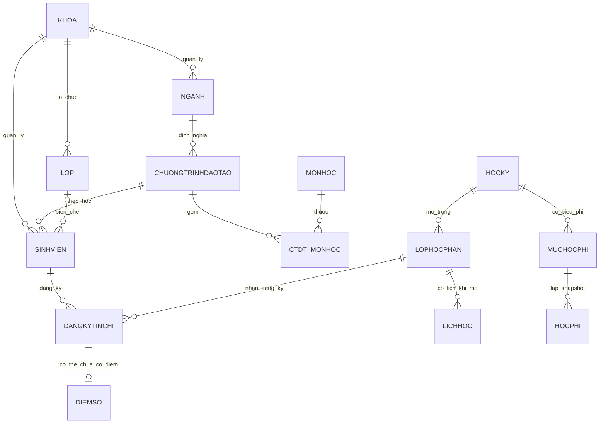

# FINAL DATABASE DESIGN – SCHEMA V1 (19 BẢNG)
> **Dự án DBMS330284 – Hệ thống Quản lý Học vụ & Đăng ký Tín chỉ Đại học**  
> **Phiên bản:** 1.5.0 | **Ngày cập nhật:** 21/10/2026  
> **Cơ sở dữ liệu:** Microsoft SQL Server 2022 | **Quy chuẩn chuẩn hóa:** Tối thiểu 3NF  

---

## TỔNG QUAN SCHEMA V1 (19 BẢNG)
Schema hiện có **19 bảng**, **6 views**, **7 functions**, **9 stored procedures**, **20 triggers bật**, 4 role nghiệp vụ. Script khai báo **19 index thường**; hiệu quả thực tế chưa được đo bằng execution plan/IO nên chưa kết luận các index đã tối ưu. Schema/seed được dựng và kiểm tra trên DB demo cô lập `DBMS330284_CodexDemo_Final` với 1.500 sinh viên, 24 CTĐT và 480 liên kết CTĐT–môn học. Ngày 21/10/2026, migration có backup được áp dụng lên `DBMS330284`; dữ liệu nghiệp vụ được giữ lại, 1.501 sinh viên còn nguyên và 24 CTĐT khóa 2023–2025 đã được xác minh.

Schema bao gồm việc chuẩn hóa tách thực thể **`NGANH`** độc lập khỏi `CHUONGTRINHDAOTAO` (quan hệ `KHOA` 1:N `NGANH` 1:N `CHUONGTRINHDAOTAO`), bổ sung **`LOP`** phục vụ quản lý sinh viên theo lớp sinh hoạt / lớp niên chế và **`CHITIETTHANHTOAN`** phục vụ nghiệp vụ thanh toán học phí nhiều đợt với cơ chế xác nhận 2 bước.

---

## 1. QUY ƯỚC TÍCH HỢP ĐỒNG BỘ LIÊN MODULE

### 1.1. Khóa liên module (Cross-Module Keys)
- `KHOA.MaKhoa`: `VARCHAR(10)` (PK); `NGANH.MaKhoa`, `LOP.MaKhoa`, `SINHVIEN.MaKhoa`, `GIANGVIEN.MaKhoa`, `MONHOC.MaKhoa` đều dùng `VARCHAR(10)` (FK).
- `LOP.MaLop`: `VARCHAR(20)` (PK); `SINHVIEN.MaLop` dùng `VARCHAR(20)` (FK).
- `NGANH.MaNganh`: `VARCHAR(10)` (PK); `CHUONGTRINHDAOTAO.MaNganh` dùng `VARCHAR(10)` (FK).
- `SINHVIEN.MaSV`: `INT IDENTITY(1,1)` (PK kỹ thuật); `MaSinhVien` `VARCHAR(20)` là mã nghiệp vụ `UNIQUE`.
- `GIANGVIEN.MaGV`: `INT IDENTITY(1,1)` (PK kỹ thuật); `MaGiangVien` `VARCHAR(20)` là mã nghiệp vụ `UNIQUE`.
- `HOCKY.MaHocKy`: `INT IDENTITY(1,1)` (PK); toàn hệ thống dùng `MaHocKy`, không dùng `MaHK`.
- `TAIKHOAN.MaTaiKhoan`: `INT IDENTITY(1,1)` (PK).

### 1.2. Dữ liệu dẫn xuất và Snapshot (Derived & Snapshot Data)
- **Không lưu sĩ số tĩnh:** Tuyệt đối không lưu cột vật lý `SoLuongHienTai` trong `LOPHOCPHAN`; sĩ số thực tế được tính toán động từ `DANGKYTINCHI WHERE TrangThai = 'REGISTERED'`. Sĩ số của `LOP` sinh hoạt tính động từ `SINHVIEN WHERE TrangThai = 'DANG_HOC'`.
- **Không lưu điểm dẫn xuất tĩnh:** Không lưu vật lý `DiemTongKet`, `DiemChu`, `DiemHe4` trong `DIEMSO`; tính toán động thông qua View `V_BangDiemChiTiet` và Function `FN_TinhDiemTongKet`. Nghiệp vụ nhập điểm của Giảng viên sử dụng cú pháp UPSERT trực tiếp vào bảng `DIEMSO`, tự động kích hoạt trigger kiểm toán `TR_DIEMSO_Audit` ghi nhận vết sửa đổi điểm số.
- **Quản lý dữ liệu Sinh viên (CRUD):** Sinh viên có `MaCTDT` bắt buộc; API kiểm tra CTĐT thuộc khoa, và nếu có lớp thì năm tuyển sinh CTĐT khớp `LOP.NamNhapHoc`. Trigger bảo vệ thay đổi từ hai phía. Thao tác xóa sinh viên có lịch sử học tập/học phí chuyển trạng thái `THOI_HOC`.
- **Snapshot học phí:** `HOCPHI` lưu snapshot `DonGiaTinChi` và `TongTien` tại thời điểm sinh viên tính học phí.
- **Cache thanh toán:** `HOCPHI.SoTienDaThanhToan` là trường cache; nguồn sự thật là bảng `CHITIETTHANHTOAN` (chỉ cộng dồn các giao dịch có `TrangThai = 'DA_XAC_NHAN'`) và được đồng bộ tự động qua Trigger `TR_CHITIETTHANHTOAN_CapNhatHocPhi`.

### 1.3. Quy tắc cốt lõi đã chốt
- Mỗi học kỳ có một đợt đăng ký tín chỉ xác định bởi `NgayMoDangKy` và `NgayDongDangKy` trong bảng `HOCKY`.
- 4 Vai trò bảo mật (`VaiTro`): `SINH_VIEN`, `GIANG_VIEN`, `DAO_TAO`, `QUAN_TRI`.
- `Email` cho phép `NULL` nhưng duy nhất riêng biệt trong từng bảng `SINHVIEN`, `GIANGVIEN` thông qua Filtered Unique Index.
- `LOGHOATDONG` lưu JSON các cột dữ liệu thay đổi (`INSERT`, `UPDATE`, `DELETE`); tuyệt đối không ghi `PasswordHash`.
- Dữ liệu lịch sử ưu tiên không xóa dây chuyền (`CASCADE`); sử dụng cờ trạng thái nghiệp vụ và FK `NO ACTION`.

---

## 2. DANH SÁCH 19 BẢNG SCHEMA V1 (PHÂN THEO KHỐI CHỨC NĂNG)

### Khối A – Đào tạo & Chương trình học (6 bảng)
1. **`KHOA`**: Đơn vị quản lý học thuật cấp khoa.
2. **`NGANH`**: Ngành đào tạo trực thuộc khoa (chuẩn hóa 3NF tách từ CTĐT).
3. **`CHUONGTRINHDAOTAO`**: Chương trình đào tạo chuyên ngành theo khóa học.
4. **`MONHOC`**: Danh mục môn học thuộc quản lý của khoa.
5. **`CTDT_MONHOC`**: Khung chương trình đào tạo (bảng nối N:N giữa CTĐT và Môn học).
6. **`MONHOCTIENQUYET`**: Cây điều kiện môn tiên quyết / khuyến nghị (quan hệ đệ quy Môn học).

### Khối B – Người dùng, Lớp sinh hoạt & Học kỳ (5 bảng)
7. **`LOP`**: Lớp sinh hoạt / lớp niên chế của sinh viên (36 lớp toàn trường).
8. **`SINHVIEN`**: Hồ sơ lý lịch sinh viên (thuộc Khoa và Lớp sinh hoạt).
9. **`GIANGVIEN`**: Hồ sơ cán bộ giảng viên.
10. **`TAIKHOAN`**: Tài khoản người dùng, mật khẩu băm SHA-256 và vai trò phân quyền.
11. **`HOCKY`**: Danh mục năm học - học kỳ và thời gian mở/đóng cổng đăng ký tín chỉ.

### Khối C – Lớp học phần & Đăng ký học vụ (4 bảng)
12. **`LOPHOCPHAN`**: Lớp học phần mở trong từng học kỳ.
13. **`LICHHOC`**: Thời khóa biểu chi tiết của lớp học phần (thứ, tiết, phòng học).
14. **`DANGKYTINCHI`**: Giao dịch đăng ký tín chỉ của sinh viên vào lớp học phần.
15. **`DIEMSO`**: Bảng điểm quá trình, giữa kỳ, cuối kỳ của lượt đăng ký tín chỉ.

### Khối D – Học phí & Hệ thống (4 bảng)
16. **`MUCHOCPHI`**: Bảng định mức đơn giá tín chỉ áp dụng theo từng học kỳ.
17. **`HOCPHI`**: Hồ sơ nghĩa vụ học phí tổng hợp của sinh viên trong từng học kỳ.
18. **`CHITIETTHANHTOAN`**: Lịch sử các đợt nộp học phí thực tế của sinh viên (cơ chế xác nhận 2 bước).
19. **`LOGHOATDONG`**: Nhật ký kiểm toán (Audit Log) theo dõi biến động dữ liệu toàn hệ thống.

---

## 3. DATA DICTIONARY HỢP NHẤT CHI TIẾT (19 BẢNG)

### 3.1. KHOA
- `MaKhoa` VARCHAR(10) NOT NULL, PK.
- `TenKhoa` NVARCHAR(100) NOT NULL, UNIQUE (`UQ_KHOA_TenKhoa`).
- `Email` VARCHAR(100) NULL.
- `SoDienThoai` VARCHAR(15) NULL.
- `TrangThai` BIT NOT NULL DEFAULT 1 (`DF_KHOA_TrangThai`).

### 3.2. NGANH
- `MaNganh` VARCHAR(10) NOT NULL, PK (`PK_NGANH`).
- `MaKhoa` VARCHAR(10) NOT NULL, FK -> `KHOA.MaKhoa` (`FK_NGANH_KHOA`).
- `TenNganh` NVARCHAR(100) NOT NULL, UNIQUE (`UQ_NGANH_TenNganh`).
- `MoTa` NVARCHAR(500) NULL.
- `TrangThai` BIT NOT NULL DEFAULT 1 (`DF_NGANH_TrangThai`).

### 3.3. CHUONGTRINHDAOTAO
- `MaCTDT` VARCHAR(24) NOT NULL, PK (`PK_CHUONGTRINHDAOTAO`).
- `MaNganh` VARCHAR(10) NOT NULL, FK -> `NGANH.MaNganh` (`FK_CHUONGTRINHDAOTAO_NGANH`).
- `TenCTDT` NVARCHAR(150) NOT NULL.
- `KhoaHoc` VARCHAR(20) NOT NULL (nhãn hiển thị).
- `NamTuyenSinh` SMALLINT NOT NULL, CHECK từ 2000 đến 2100.
- `TongTinChiYeuCau` INT NOT NULL, CHECK > 0 (`CK_CHUONGTRINHDAOTAO_TongTinChi`).
- `ThoiGianDaoTao` INT NOT NULL, CHECK > 0 (`CK_CHUONGTRINHDAOTAO_ThoiGian`).
- `TrangThai` BIT NOT NULL DEFAULT 1 (`DF_CHUONGTRINHDAOTAO_TrangThai`).

### 3.4. MONHOC
- `MaMonHoc` VARCHAR(15) NOT NULL, PK (`PK_MONHOC`).
- `MaKhoa` VARCHAR(10) NOT NULL, FK -> `KHOA.MaKhoa` (`FK_MONHOC_KHOA`).
- `TenMonHoc` NVARCHAR(150) NOT NULL.
- `SoTinChi` TINYINT NOT NULL, CHECK > 0 (`CK_MONHOC_SoTinChi`).
- `SoTietLyThuyet` SMALLINT NOT NULL, CHECK >= 0 (`CK_MONHOC_SoTietLyThuyet`).
- `SoTietThucHanh` SMALLINT NOT NULL, CHECK >= 0 (`CK_MONHOC_SoTietThucHanh`).
- `MoTa` NVARCHAR(500) NULL.
- `TrangThai` BIT NOT NULL DEFAULT 1 (`DF_MONHOC_TrangThai`).

### 3.5. CTDT_MONHOC
- `MaCTDT` VARCHAR(24) NOT NULL, PK/FK -> `CHUONGTRINHDAOTAO.MaCTDT` (`FK_CTDT_MONHOC_CTDT`).
- `MaMonHoc` VARCHAR(15) NOT NULL, PK/FK -> `MONHOC.MaMonHoc` (`FK_CTDT_MONHOC_MONHOC`).
- `HocKyDuKien` TINYINT NOT NULL, CHECK > 0 (`CK_CTDT_MONHOC_HocKyDuKien`).
- `LoaiMon` VARCHAR(20) NOT NULL, CHECK IN ('BAT_BUOC', 'TU_CHON') (`CK_CTDT_MONHOC_LoaiMon`).
- `ThuTu` SMALLINT NULL, CHECK (ThuTu IS NULL OR ThuTu > 0) (`CK_CTDT_MONHOC_ThuTu`).
- PK ghép: `(MaCTDT, MaMonHoc)` (`PK_CTDT_MONHOC`).

### 3.6. MONHOCTIENQUYET
- `MaMonHoc` VARCHAR(15) NOT NULL, PK/FK -> `MONHOC.MaMonHoc` (`FK_MONHOCTIENQUYET_MONHOC`).
- `MaMonTienQuyet` VARCHAR(15) NOT NULL, PK/FK -> `MONHOC.MaMonHoc` (`FK_MONHOCTIENQUYET_MONHOCTIENQUYET`).
- `MucDo` VARCHAR(20) NOT NULL DEFAULT 'BAT_BUOC', CHECK IN ('BAT_BUOC', 'KHUYEN_NGHI') (`CK_MONHOCTIENQUYET_MucDo`).
- PK ghép: `(MaMonHoc, MaMonTienQuyet)` (`PK_MONHOCTIENQUYET`).
- CHECK: `MaMonHoc <> MaMonTienQuyet` (`CK_MONHOCTIENQUYET_MaMonHoc`).
- Kiểm soát chu trình đệ quy nhiều cấp thông qua Trigger `TR_MONHOCTIENQUYET_KiemTraChuTrinh`.

### 3.7. LOP
- `MaLop` VARCHAR(20) NOT NULL, PK (`PK_LOP`).
- `TenLop` NVARCHAR(100) NOT NULL.
- `MaKhoa` VARCHAR(10) NOT NULL, FK -> `KHOA.MaKhoa` (`FK_LOP_KHOA`).
- `KhoaHoc` VARCHAR(20) NOT NULL.
- `NamNhapHoc` INT NOT NULL.
- `TrangThai` BIT NOT NULL DEFAULT 1 (`DF_LOP_TrangThai`).

### 3.8. SINHVIEN
- `MaSV` INT IDENTITY(1,1) NOT NULL, PK (`PK_SINHVIEN`).
- `MaSinhVien` VARCHAR(20) NOT NULL, UNIQUE (`UQ_SINHVIEN_MaSinhVien`).
- `HoTen` NVARCHAR(100) NOT NULL.
- `NgaySinh` DATE NULL.
- `Email` VARCHAR(254) NULL, Filtered Unique Index (`UQ_SINHVIEN_Email` WHERE Email IS NOT NULL).
- `SoDienThoai` VARCHAR(20) NULL.
- `MaKhoa` VARCHAR(10) NOT NULL, FK -> `KHOA.MaKhoa` (`FK_SINHVIEN_KHOA`).
- `MaLop` VARCHAR(20) NULL, FK -> `LOP.MaLop` (`FK_SINHVIEN_LOP`); sinh viên có thể chưa được biên chế lớp.
- `MaCTDT` VARCHAR(24) NOT NULL, FK -> `CHUONGTRINHDAOTAO.MaCTDT` (`FK_SINHVIEN_CTDT`).
- `TrangThai` VARCHAR(20) NOT NULL DEFAULT 'DANG_HOC', CHECK IN ('DANG_HOC', 'BAO_LUU', 'TOT_NGHIEP', 'THOI_HOC') (`CK_SINHVIEN_TrangThai`).
- `NgayTao` DATETIME2(0) NOT NULL DEFAULT SYSUTCDATETIME() (`DF_SINHVIEN_NgayTao`).
- **Cơ chế nhất quán Khoa ↔ Lớp ↔ Ngành ↔ CTĐT:** Trigger `TR_SINHVIEN_KiemTraKhoaLop` kiểm tra theo tập hợp khoa sinh viên khớp khoa lớp và khoa ngành CTĐT; năm tuyển sinh CTĐT khớp `LOP.NamNhapHoc`. Trigger trên `LOP`, `NGANH` và `CHUONGTRINHDAOTAO` chặn thay đổi phía cha làm mất nhất quán. Lỗi nghiệp vụ dùng mã 51008.

### 3.9. GIANGVIEN
- `MaGV` INT IDENTITY(1,1) NOT NULL, PK (`PK_GIANGVIEN`).
- `MaGiangVien` VARCHAR(20) NOT NULL, UNIQUE (`UQ_GIANGVIEN_MaGiangVien`).
- `HoTen` NVARCHAR(100) NOT NULL.
- `Email` VARCHAR(254) NULL, Filtered Unique Index (`UQ_GIANGVIEN_Email` WHERE Email IS NOT NULL).
- `SoDienThoai` VARCHAR(20) NULL.
- `MaKhoa` VARCHAR(10) NOT NULL, FK -> `KHOA.MaKhoa` (`FK_GIANGVIEN_KHOA`).
- `TrangThai` VARCHAR(20) NOT NULL DEFAULT 'DANG_CONG_TAC', CHECK IN ('DANG_CONG_TAC', 'TAM_NGHI', 'NGHI_VIEC') (`CK_GIANGVIEN_TrangThai`).
- `NgayTao` DATETIME2(0) NOT NULL DEFAULT SYSUTCDATETIME() (`DF_GIANGVIEN_NgayTao`).

### 3.10. TAIKHOAN
- `MaTaiKhoan` INT IDENTITY(1,1) NOT NULL, PK (`PK_TAIKHOAN`).
- `Username` VARCHAR(50) NOT NULL, UNIQUE (`UQ_TAIKHOAN_Username`).
- `PasswordHash` VARCHAR(255) NOT NULL (mã băm SHA-256 dùng cho demo/kiểm thử đồ án).
- `VaiTro` VARCHAR(30) NOT NULL, CHECK IN ('SINH_VIEN', 'GIANG_VIEN', 'DAO_TAO', 'QUAN_TRI') (`CK_TAIKHOAN_VaiTro`).
- `TrangThai` VARCHAR(20) NOT NULL DEFAULT 'ACTIVE', CHECK IN ('ACTIVE', 'LOCKED', 'DISABLED') (`CK_TAIKHOAN_TrangThai`).
- `MaSV` INT NULL, FK -> `SINHVIEN.MaSV` (`FK_TAIKHOAN_SINHVIEN`), Filtered Unique Index (`UQ_TAIKHOAN_MaSV` WHERE MaSV IS NOT NULL).
- `MaGV` INT NULL, FK -> `GIANGVIEN.MaGV` (`FK_TAIKHOAN_GIANGVIEN`), Filtered Unique Index (`UQ_TAIKHOAN_MaGV` WHERE MaGV IS NOT NULL).
- `NgayTao` DATETIME2(0) NOT NULL DEFAULT SYSUTCDATETIME() (`DF_TAIKHOAN_NgayTao`).
- `LanDangNhapCuoi` DATETIME2(0) NULL.
- CHECK: Không cho phép `MaSV` và `MaGV` đồng thời khác `NULL` (`CK_TAIKHOAN_NguoiDung`: `NOT (MaSV IS NOT NULL AND MaGV IS NOT NULL)`).
- Ràng buộc tương thích vai trò ↔ khóa người dùng được kiểm soát chặt chẽ ở cấp Stored Procedure `SP_TaoTaiKhoan` (Role `SINH_VIEN` bắt buộc có `MaSV`, Role `GIANG_VIEN` bắt buộc có `MaGV`, Role `DAO_TAO`/`QUAN_TRI` không gắn mã; mã lỗi 51004).

### 3.11. HOCKY
- `MaHocKy` INT IDENTITY(1,1) NOT NULL, PK (`PK_HOCKY`).
- `NamHoc` VARCHAR(9) NOT NULL.
- `TenHocKy` NVARCHAR(30) NOT NULL.
- `NgayBatDau` DATE NOT NULL.
- `NgayKetThuc` DATE NOT NULL.
- `NgayMoDangKy` DATETIME2 NOT NULL.
- `NgayDongDangKy` DATETIME2 NOT NULL.
- `TrangThai` VARCHAR(20) NOT NULL DEFAULT 'CHUA_MO', CHECK IN ('CHUA_MO', 'DANG_MO', 'KET_THUC') (`CK_HOCKY_TrangThai`).
- UNIQUE: `(NamHoc, TenHocKy)` (`UQ_HOCKY_NamHoc_TenHocKy`).
- CHECK: `NgayBatDau <= NgayKetThuc` (`CK_HOCKY_NgayHoc`).
- CHECK: `NgayMoDangKy <= NgayDongDangKy` (`CK_HOCKY_DangKy`).

### 3.12. LOPHOCPHAN
- `MaLHP` VARCHAR(20) NOT NULL, PK (`PK_LOPHOCPHAN`).
- `MaMonHoc` VARCHAR(15) NOT NULL, FK -> `MONHOC.MaMonHoc` (`FK_LOPHOCPHAN_MONHOC`).
- `MaHocKy` INT NOT NULL, FK -> `HOCKY.MaHocKy` (`FK_LOPHOCPHAN_HOCKY`).
- `MaGiangVien` INT NULL, FK -> `GIANGVIEN.MaGV` (`FK_LOPHOCPHAN_GIANGVIEN`).
- `TenLHP` NVARCHAR(100) NOT NULL.
- `SoLuongToiDa` INT NOT NULL DEFAULT 50, CHECK > 0 (`CK_LOPHOCPHAN_SoLuongToiDa`).
- `TrangThai` VARCHAR(20) NOT NULL DEFAULT 'MO_DANG_KY', CHECK IN ('MO_DANG_KY', 'DANG_MO', 'DA_KHOA', 'DA_HUY') (`CK_LOPHOCPHAN_TrangThai`).
  - `MO_DANG_KY`: Đang trong đợt đăng ký tín chỉ, sinh viên được phép đăng ký/hủy.
  - `DANG_MO`: Đã đóng đăng ký, lớp đang diễn ra giảng dạy học tập.
  - `DA_KHOA`: Đã hoàn thành nhập điểm, kết thúc lớp học phần.
  - `DA_HUY`: Hủy mở lớp do không đủ sĩ số tối thiểu.

### 3.13. LICHHOC
- `MaLichHoc` INT IDENTITY(1,1) NOT NULL, PK (`PK_LICHHOC`).
- `MaLHP` VARCHAR(20) NOT NULL, FK -> `LOPHOCPHAN.MaLHP` (`FK_LICHHOC_LOPHOCPHAN`).
- `Thu` TINYINT NOT NULL, CHECK BETWEEN 2 AND 8 (`CK_LICHHOC_Thu`).
- `TietBatDau` TINYINT NOT NULL, CHECK BETWEEN 1 AND 12 (`CK_LICHHOC_TietBatDau`).
- `SoTiet` TINYINT NOT NULL, CHECK BETWEEN 1 AND 6 (`CK_LICHHOC_SoTiet`).
- `PhongHoc` VARCHAR(20) NOT NULL.
- CHECK: `TietBatDau + SoTiet - 1 <= 12` (`CK_LICHHOC_TietKetThuc`).

### 3.14. DANGKYTINCHI
- `MaDangKy` BIGINT IDENTITY(1,1) NOT NULL, PK (`PK_DANGKYTINCHI`).
- `MaSV` INT NOT NULL, FK -> `SINHVIEN.MaSV` (`FK_DANGKYTINCHI_SINHVIEN`).
- `MaLHP` VARCHAR(20) NOT NULL, FK -> `LOPHOCPHAN.MaLHP` (`FK_DANGKYTINCHI_LOPHOCPHAN`).
- `NgayDangKy` DATETIME2 NOT NULL DEFAULT SYSUTCDATETIME() (`DF_DANGKYTINCHI_NgayDangKy`).
- `TrangThai` VARCHAR(20) NOT NULL DEFAULT 'REGISTERED', CHECK IN ('REGISTERED', 'CANCELLED') (`CK_DANGKYTINCHI_TrangThai`).
- Filtered Unique Index: `(MaSV, MaLHP) WHERE TrangThai = 'REGISTERED'` (`UQ_DANGKYTINCHI_SinhVien_LopHocPhan`).

### 3.15. DIEMSO
- `MaDangKy` BIGINT NOT NULL, PK/FK -> `DANGKYTINCHI.MaDangKy` (`PK_DIEMSO`, `FK_DIEMSO_DANGKYTINCHI`).
- `DiemQuaTrinh` DECIMAL(4,2) NULL, CHECK (DiemQuaTrinh IS NULL OR DiemQuaTrinh BETWEEN 0 AND 10).
- `DiemGiuaKy` DECIMAL(4,2) NULL, CHECK (DiemGiuaKy IS NULL OR DiemGiuaKy BETWEEN 0 AND 10).
- `DiemCuoiKy` DECIMAL(4,2) NULL, CHECK (DiemCuoiKy IS NULL OR DiemCuoiKy BETWEEN 0 AND 10).
- `TyTrongQT` TINYINT NOT NULL DEFAULT 20 (`DF_DIEMSO_TyTrongQT`).
- `TyTrongGK` TINYINT NOT NULL DEFAULT 30 (`DF_DIEMSO_TyTrongGK`).
- `TyTrongCK` TINYINT NOT NULL DEFAULT 50 (`DF_DIEMSO_TyTrongCK`).
- CHECK: `TyTrongQT + TyTrongGK + TyTrongCK = 100` (`CK_DIEMSO_TyTrong`).

### 3.16. MUCHOCPHI
- `MaMucHocPhi` INT IDENTITY(1,1) NOT NULL, PK (`PK_MUCHOCPHI`).
- `MaHocKy` INT NOT NULL, FK -> `HOCKY.MaHocKy` (`FK_MUCHOCPHI_HOCKY`).
- `PhamViApDung` VARCHAR(50) NOT NULL, CHECK (`PhamViApDung = 'TOAN_TRUONG'`).
- `DonGiaTinChi` DECIMAL(12,2) NOT NULL, CHECK > 0 (`CK_MUCHOCPHI_DonGia`).
- `NgayHieuLuc` DATE NOT NULL.
- `NgayHetHieuLuc` DATE NULL.
- `TrangThai` VARCHAR(20) NOT NULL DEFAULT 'ACTIVE', CHECK IN ('ACTIVE', 'INACTIVE') (`CK_MUCHOCPHI_TrangThai`).
- CHECK: `NgayHetHieuLuc IS NULL OR NgayHetHieuLuc >= NgayHieuLuc` (`CK_MUCHOCPHI_NgayHieuLuc`).
- Trigger `TR_MUCHOCPHI_KiemTraHieuLuc` chặn trùng khoảng thời gian hiệu lực cho mức ACTIVE.

### 3.17. HOCPHI
- `MaHocPhi` INT IDENTITY(1,1) NOT NULL, PK (`PK_HOCPHI`).
- `MaSV` INT NOT NULL, FK -> `SINHVIEN.MaSV` (`FK_HOCPHI_SINHVIEN`).
- `MaHocKy` INT NOT NULL, FK -> `HOCKY.MaHocKy` (`FK_HOCPHI_HOCKY`).
- `MaMucHocPhi` INT NOT NULL, FK -> `MUCHOCPHI.MaMucHocPhi` (`FK_HOCPHI_MUCHOCPHI`).
- `SoTinChi` INT NOT NULL, CHECK > 0 (`CK_HOCPHI_SoTinChi`).
- `DonGiaTinChi` DECIMAL(12,2) NOT NULL, CHECK > 0 (`CK_HOCPHI_DonGia`).
- `TongTien` DECIMAL(14,2) NOT NULL, CHECK >= 0 (`CK_HOCPHI_TongTien`).
- `SoTienDaThanhToan` DECIMAL(14,2) NOT NULL DEFAULT 0 (`DF_HOCPHI_SoTienDaThanhToan`).
- `TrangThai` VARCHAR(20) NOT NULL DEFAULT 'UNPAID', CHECK IN ('UNPAID', 'PARTIAL', 'PAID') (`CK_HOCPHI_TrangThai`).
- `NgayCapNhat` DATETIME2 NOT NULL DEFAULT SYSUTCDATETIME() (`DF_HOCPHI_NgayCapNhat`).
- UNIQUE: `(MaSV, MaHocKy)` (`UQ_HOCPHI_SinhVien_HocKy`).
- CHECK: `SoTienDaThanhToan >= 0 AND SoTienDaThanhToan <= TongTien` (`CK_HOCPHI_SoTienDaThanhToan`).

### 3.18. CHITIETTHANHTOAN (Cơ chế xác nhận 2 bước)
- `MaThanhToan` BIGINT IDENTITY(1,1) NOT NULL, PK (`PK_CHITIETTHANHTOAN`).
- `MaHocPhi` INT NOT NULL, FK -> `HOCPHI.MaHocPhi` (`FK_CHITIETTHANHTOAN_HOCPHI`).
- `SoTien` DECIMAL(14,2) NOT NULL, CHECK > 0 (`CK_CHITIETTHANHTOAN_SoTien`).
- `NgayThanhToan` DATETIME2 NOT NULL DEFAULT SYSUTCDATETIME() (`DF_CHITIETTHANHTOAN_NgayThanhToan`).
- `PhuongThuc` VARCHAR(20) NOT NULL, CHECK IN ('TIEN_MAT', 'CHUYEN_KHOAN') (`CK_CHITIETTHANHTOAN_PhuongThuc`).
- `TrangThai` VARCHAR(20) NOT NULL DEFAULT 'CHO_XAC_NHAN', CHECK IN ('CHO_XAC_NHAN', 'DA_XAC_NHAN', 'TU_CHOI') (`CK_CHITIETTHANHTOAN_TrangThai`).
- `MaTaiKhoanXacNhan` INT NULL, FK -> `TAIKHOAN.MaTaiKhoan` (`FK_CHITIETTHANHTOAN_TAIKHOAN`).
- `NgayXacNhan` DATETIME2 NULL.
- **Quy tắc kích hoạt Trigger:** Trigger `TR_CHITIETTHANHTOAN_CapNhatHocPhi` chỉ cộng dồn `SoTien` vào `HOCPHI.SoTienDaThanhToan` và đổi trạng thái (`PARTIAL` / `PAID`) đối với những giao dịch có `TrangThai = 'DA_XAC_NHAN'`. Giao dịch `CHO_XAC_NHAN` hoặc `TU_CHOI` không làm thay đổi số dư công nợ.

### 3.19. LOGHOATDONG
- `MaLog` BIGINT IDENTITY(1,1) NOT NULL, PK (`PK_LOGHOATDONG`).
- `MaTaiKhoan` INT NULL, FK -> `TAIKHOAN.MaTaiKhoan` (`FK_LOGHOATDONG_TAIKHOAN`).
- `ThoiGian` DATETIME2 NOT NULL DEFAULT SYSUTCDATETIME() (`DF_LOGHOATDONG_ThoiGian`).
- `HanhDong` VARCHAR(20) NOT NULL, CHECK IN ('INSERT', 'UPDATE', 'DELETE') (`CK_LOGHOATDONG_HanhDong`).
- `TenBang` VARCHAR(128) NOT NULL.
- `KhoaBanGhi` NVARCHAR(200) NULL.
- `NoiDungCu` NVARCHAR(MAX) NULL (JSON).
- `NoiDungMoi` NVARCHAR(MAX) NULL (JSON).

---

## 4. QUAN HỆ CHÍNH (CARDINALITY & FOREIGN KEYS)

```text
[KHOA] 1 ────────────< N [NGANH]
[NGANH] 1 ───────────< N [CHUONGTRINHDAOTAO]
[KHOA] 1 ────────────< N [LOP]
[LOP] 1 ─────────────< N [SINHVIEN]
[KHOA] 1 ────────────< N [MONHOC]
[KHOA] 1 ────────────< N [SINHVIEN]
[KHOA] 1 ────────────< N [GIANGVIEN]

[CHUONGTRINHDAOTAO] 1 ──< N [CTDT_MONHOC] >── 1 [MONHOC] (N:N)
[MONHOC] 1 ─────────────< N [MONHOCTIENQUYET] >── 1 [MONHOC] (Tự quan hệ N:N)
[MONHOC] 1 ─────────────< N [LOPHOCPHAN]
[HOCKY] 1 ──────────────< N [LOPHOCPHAN]
[GIANGVIEN] 1 ──────────< N [LOPHOCPHAN]

[LOPHOCPHAN] 1 ─────────< N [LICHHOC]
[SINHVIEN] 1 ───────────< N [DANGKYTINCHI]
[LOPHOCPHAN] 1 ─────────< N [DANGKYTINCHI]
[DANGKYTINCHI] 1 ─────── 1 [DIEMSO] (1:1 qua MaDangKy)

[SINHVIEN] 1 ─────────── 0..1 [TAIKHOAN]
[GIANGVIEN] 1 ────────── 0..1 [TAIKHOAN]
[TAIKHOAN] 1 ───────────< N [LOGHOATDONG]

[HOCKY] 1 ──────────────< N [MUCHOCPHI]
[MUCHOCPHI] 1 ──────────< N [HOCPHI]
[SINHVIEN] 1 ───────────< N [HOCPHI]
[HOCKY] 1 ──────────────< N [HOCPHI]
[HOCPHI] 1 ─────────────< N [CHITIETTHANHTOAN]
```

---

## 5. BUSINESS RULES LIÊN MODULE (18 QUY TẮC TOÀN VẸN)

- **BR01:** Sinh viên chỉ được đăng ký môn khi trạng thái là `DANG_HOC` và tài khoản ở trạng thái `ACTIVE`.
- **BR02:** Môn tiên quyết `BAT_BUOC` được xem là hoàn thành khi điểm tổng kết của sinh viên đạt `>= 5.0`.
- **BR03:** Số lượng sinh viên đăng ký `REGISTERED` trong một lớp học phần không được vượt quá `SoLuongToiDa`.
- **BR04:** Sinh viên không được phép đăng ký hai lớp học phần có lịch học trùng/giao nhau trong cùng học kỳ.
- **BR05:** Không xếp cùng một giảng viên hoặc cùng một phòng học cho hai lớp học phần khác nhau trong cùng khung giờ.
- **BR06:** Đăng ký và hủy học phần chỉ được thực hiện trong khoảng thời gian `NgayMoDangKy` đến `NgayDongDangKy` và `HOCKY.TrangThai = 'DANG_MO'`.
- **BR07:** Tổng tỷ trọng điểm thành phần trong `DIEMSO` (`TyTrongQT + TyTrongGK + TyTrongCK`) bắt buộc phải bằng 100%.
- **BR08:** Tuyệt đối không cho phép tạo chu trình phụ thuộc vòng lặp giữa các môn tiên quyết.
- **BR09:** Đăng ký bị hủy (`CANCELLED`) không được tính vào sĩ số thực tế và không tính vào học phí.
- **BR10:** Mỗi sinh viên có tối đa một hồ sơ `HOCPHI` cho mỗi học kỳ (`UNIQUE(MaSV, MaHocKy)`).
- **BR11:** `HOCPHI` tham chiếu `MUCHOCPHI` đang có hiệu lực (`ACTIVE`) tại thời điểm tính và lưu snapshot `DonGiaTinChi`, `TongTien`.
- **BR12:** `MUCHOCPHI.PhamViApDung` phiên bản 1 chỉ áp dụng giá trị `'TOAN_TRUONG'`.
- **BR13:** Một hồ sơ `HOCPHI` có thể thanh toán nhiều đợt thông qua `CHITIETTHANHTOAN`; tổng tiền nộp không được vượt quá `TongTien`.
- **BR14:** `SoTienDaThanhToan` và `TrangThai` của `HOCPHI` phải được cập nhật đồng bộ tự động khi có biến động giao dịch thanh toán xác nhận (`DA_XAC_NHAN`).
- **BR15:** Audit log ghi nhận mã tài khoản, thời gian, hành động, tên bảng và chuỗi JSON các trường thay đổi; tuyệt đối không ghi `PasswordHash`.
- **BR16:** Email được phép `NULL` nhưng nếu có giá trị thì không được phép trùng lặp trong cùng bảng `SINHVIEN` hoặc `GIANGVIEN`.
- **BR17:** Dữ liệu lịch sử đã được tham chiếu không xóa cứng (`NO ACTION`); chỉ đổi cờ trạng thái nghiệp vụ.
- **BR18:** Mỗi chương trình đào tạo bắt buộc trực thuộc một ngành học (`NGANH`); mỗi ngành học trực thuộc một khoa (`KHOA`).
- **BR19:** Khoa của sinh viên, khoa ngành của CTĐT và khoa của lớp phải thống nhất; năm tuyển sinh CTĐT phải trùng `LOP.NamNhapHoc`. Trigger theo tập hợp bảo vệ cả cập nhật sinh viên lẫn cập nhật CTĐT/ngành/lớp (mã lỗi 51008).
- **BR20:** CTĐT có thể chưa có môn trong lúc khởi tạo; lượt đăng ký có thể chưa có điểm; lớp học phần nháp (`DA_KHOA`) có thể chưa có lịch. Khi mở lớp (`MO_DANG_KY`/`DANG_MO`) phải tồn tại lịch học, và không thể xóa lịch cuối của lớp đang mở.
- **BR21:** Sức chứa LHP không được giảm thấp hơn sĩ số đã đăng ký. `HOCPHI` tham chiếu `(MaMucHocPhi, MaHocKy)` ghép để ngăn mức phí sai học kỳ.

---

## 6. PHÂN TÍCH PHỤ THUỘC HÀM VÀ CHỨNG MINH CHUẨN HÓA (1NF, 2NF, 3NF)

### 6.1. Bảng xác định Khóa chính và Khóa ứng viên (Candidate Keys)
Hệ thống xác định chính xác các khóa ứng viên cho từng thực thể làm cơ sở phân tích phụ thuộc hàm:
- `KHOA`: Khóa chính `MaKhoa`; Khóa ứng viên thay thế `TenKhoa`.
- `NGANH`: Khóa chính `MaNganh`; Khóa ứng viên thay thế `TenNganh`.
- `CHUONGTRINHDAOTAO`: Khóa chính `MaCTDT`.
- `MONHOC`: Khóa chính `MaMonHoc`.
- `CTDT_MONHOC`: Khóa chính ghép `(MaCTDT, MaMonHoc)`.
- `MONHOCTIENQUYET`: Khóa chính ghép `(MaMonHoc, MaMonTienQuyet)`.
- `LOP`: Khóa chính `MaLop`.
- `SINHVIEN`: Khóa chính `MaSV` (Surrogate Key); Khóa ứng viên tự nhiên `MaSinhVien`, `Email` (Filtered Unique).
- `GIANGVIEN`: Khóa chính `MaGV` (Surrogate Key); Khóa ứng viên tự nhiên `MaGiangVien`, `Email` (Filtered Unique).
- `TAIKHOAN`: Khóa chính `MaTaiKhoan`; Khóa ứng viên `Username`, `MaSV` (Filtered), `MaGV` (Filtered).
- `HOCKY`: Khóa chính `MaHocKy`; Khóa ứng viên ghép `(NamHoc, TenHocKy)`.
- `LOPHOCPHAN`: Khóa chính `MaLHP`.
- `LICHHOC`: Khóa chính `MaLichHoc`.
- `DANGKYTINCHI`: Khóa chính `MaDangKy`; Khóa ứng viên ghép `(MaSV, MaLHP)` lọc theo `TrangThai = 'REGISTERED'`.
- `DIEMSO`: Khóa chính `MaDangKy` (Quan hệ 1:1 xác định qua `DANGKYTINCHI`).
- `MUCHOCPHI`: Khóa chính `MaMucHocPhi`.
- `HOCPHI`: Khóa chính `MaHocPhi`; Khóa ứng viên ghép `(MaSV, MaHocKy)`.
- `CHITIETTHANHTOAN`: Khóa chính `MaThanhToan`.
- `LOGHOATDONG`: Khóa chính `MaLog`.

### 6.2. Tập các Phụ thuộc hàm cốt lõi (Functional Dependencies - FDs)
1. `KHOA`: $MaKhoa \rightarrow \{TenKhoa, Email, SoDienThoai, TrangThai\}$
2. `NGANH`: $MaNganh \rightarrow \{MaKhoa, TenNganh, MoTa, TrangThai\}$
3. `CHUONGTRINHDAOTAO`: $MaCTDT \rightarrow \{MaNganh, TenCTDT, KhoaHoc, NamTuyenSinh, TongTinChiYeuCau, ThoiGianDaoTao, TrangThai\}$
4. `LOP`: $MaLop \rightarrow \{TenLop, MaKhoa, KhoaHoc, NamNhapHoc, TrangThai\}$
5. `SINHVIEN`: $MaSV \rightarrow \{MaSinhVien, HoTen, NgaySinh, Email, SoDienThoai, MaKhoa, MaLop, TrangThai, NgayTao\}$
6. `MONHOC`: $MaMonHoc \rightarrow \{MaKhoa, TenMonHoc, SoTinChi, SoTietLyThuyet, SoTietThucHanh, MoTa, TrangThai\}$
7. `CTDT_MONHOC`: $(MaCTDT, MaMonHoc) \rightarrow \{HocKyDuKien, LoaiMon, ThuTu\}$
8. `MONHOCTIENQUYET`: $(MaMonHoc, MaMonTienQuyet) \rightarrow \{MucDo\}$
9. `LOPHOCPHAN`: $MaLHP \rightarrow \{MaMonHoc, MaHocKy, MaGiangVien, TenLHP, SoLuongToiDa, TrangThai\}$
10. `DANGKYTINCHI`: $MaDangKy \rightarrow \{MaSV, MaLHP, NgayDangKy, TrangThai\}$
11. `DIEMSO`: $MaDangKy \rightarrow \{DiemQuaTrinh, DiemGiuaKy, DiemCuoiKy, TyTrongQT, TyTrongGK, TyTrongCK\}$
12. `HOCPHI`: $MaHocPhi \rightarrow \{MaSV, MaHocKy, MaMucHocPhi, SoTinChi, DonGiaTinChi, TongTien, SoTienDaThanhToan, TrangThai, NgayCapNhat\}$
13. `CHITIETTHANHTOAN`: $MaThanhToan \rightarrow \{MaHocPhi, SoTien, NgayThanhToan, PhuongThuc, TrangThai, MaTaiKhoanXacNhan, NgayXacNhan\}$

### 6.3. Đánh giá Chuẩn 1 (1NF) và Chuẩn 2 (2NF)
- **1NF (First Normal Form):** Toàn bộ các thuộc tính nghiệp vụ đều mang giá trị nguyên tử (Atomic Values). Không chứa thuộc tính đa trị (Multivalued Attributes) hoặc nhóm lặp (Repeating Groups):
  - Khung chương trình đào tạo chứa nhiều môn học được tách thành quan hệ N:N `CTDT_MONHOC`.
  - Danh mục môn tiên quyết nhiều cấp được tách thành quan hệ đệ quy `MONHOCTIENQUYET`.
  - Một lớp học phần có nhiều buổi học được tách thành bảng `LICHHOC`.
  - Một hồ sơ học phí có thể nộp nhiều đợt được tách thành bảng `CHITIETTHANHTOAN`.
  - Cột JSON (`NoiDungCu`, `NoiDungMoi`) trong `LOGHOATDONG` chỉ lưu trữ payload kiểm toán bất biến (Audit Trail), không dùng để thay thế cấu trúc dữ liệu quan hệ.
- **2NF (Second Normal Form):** Đạt 1NF và loại bỏ hoàn toàn phụ thuộc hàm bộ phận (Partial Functional Dependencies). Mọi thuộc tính không khóa phải phụ thuộc hàm đầy đủ vào toàn bộ khóa chính:
  - Tất cả các bảng có khóa chính đơn thuộc tính (`KHOA`, `NGANH`, `LOP`, `SINHVIEN`, `GIANGVIEN`, `MONHOC`, `LOPHOCPHAN`, `HOCKY`, `HOCPHI`,...) mặc nhiên thỏa mãn 2NF.
  - Các bảng có khóa chính ghép:
    - Trong `CTDT_MONHOC(MaCTDT, MaMonHoc)`: Các thuộc tính `HocKyDuKien`, `LoaiMon`, `ThuTu` phụ thuộc vào cả cặp $(MaCTDT, MaMonHoc)$. Thuộc tính môn học (`TenMonHoc`, `SoTinChi`) không nằm trong bảng này mà nằm tại `MONHOC`, triệt tiêu phụ thuộc bộ phận vào `MaMonHoc`.
    - Trong `MONHOCTIENQUYET(MaMonHoc, MaMonTienQuyet)`: Thuộc tính `MucDo` phụ thuộc vào cả cặp khóa ghép.

### 6.4. Đánh giá và Chứng minh Chuẩn 3 (3NF)
Một lược đồ quan hệ đạt 3NF nếu đạt 2NF và không chứa phụ thuộc bắc cầu (Transitive Functional Dependencies) giữa các thuộc tính không khóa, tức là không tồn tại $X \rightarrow Y \rightarrow Z$ với $Z$ không thuộc khóa ứng viên.

#### A. Phân rã chuẩn hóa tách thực thể NGANH khỏi CHUONGTRINHDAOTAO
- *Trước chuẩn hóa:* Nếu gộp chung, ta có phụ thuộc hàm: $MaCTDT \rightarrow MaNganh$ và $MaNganh \rightarrow MaKhoa$. Khi đó $MaCTDT \rightarrow MaKhoa$ là một phụ thuộc bắc cầu dẫn tới dị thường lặp lại thông tin Khoa cho mọi CTĐT cùng ngành.
- *Sau phân rã:* Hệ thống tách thành chuỗi phân cấp 3 thực thể độc lập:
  - $R_1$: `KHOA(MaKhoa, TenKhoa, ...)` với $PK = MaKhoa$.
  - $R_2$: `NGANH(MaNganh, MaKhoa, TenNganh, ...)` với $PK = MaNganh$, $FK = MaKhoa$.
  - $R_3$: `CHUONGTRINHDAOTAO(MaCTDT, MaNganh, ...)` với $PK = MaCTDT$, $FK = MaNganh$.
- *Đánh giá:* Phép phân rã tách Khoa, Ngành và CTĐT theo các phụ thuộc đã nêu. Đây là phân tích thiết kế; chưa coi là chứng minh mọi bảng đạt 3NF khi chưa rà đủ phụ thuộc hàm nghiệp vụ.

#### B. Phân tích quan hệ SINHVIEN – LOP – KHOA và Kỹ thuật Phi chuẩn hóa có kiểm soát
- *Phụ thuộc hàm thực tế:*
  - $FD_1: MaSV \rightarrow MaLop$ (Mỗi sinh viên được phân vào tối đa một lớp sinh hoạt).
  - $FD_2: MaLop \rightarrow MaKhoa$ (Mỗi lớp sinh hoạt thuộc quản lý của một khoa).
  - Khi sinh viên đã có lớp, tồn tại phụ thuộc bắc cầu: $MaSV \rightarrow MaLop \rightarrow MaKhoa$.
- *Quyết định thiết kế (Controlled Denormalization):*
  Hệ thống duy trì thuộc tính `SINHVIEN.MaKhoa` trực tiếp trong bảng `SINHVIEN` thay vì chỉ lưu `MaLop` vì 2 yêu cầu nghiệp vụ bắt buộc:
  1. **Nghiệp vụ sinh viên chưa biên chế lớp:** Sinh viên mới trúng tuyển nhập học, sinh viên tự do hoặc chuyển trường có thể tạm thời chưa được phân vào Lớp sinh hoạt (`MaLop IS NULL`). Tuy nhiên, sinh viên luôn bắt buộc phải thuộc một Khoa chủ quản quản lý hồ sơ học vụ (`MaKhoa NOT NULL`). Nếu loại bỏ `SINHVIEN.MaKhoa`, hệ thống không thể lưu trữ sinh viên chưa có lớp.
  2. **Hiệu năng truy vấn & Phân quyền cấp Khoa:** Việc tra cứu, thống kê và áp dụng bộ lọc dữ liệu theo Khoa (Row-Level Security cho cán bộ quản lý khoa) được thực thi tức thì với chi phí $O(1)$ trên chỉ mục `IX_SINHVIEN_MaKhoa` mà không phải thực hiện phép `JOIN` qua bảng `LOP` (tránh rủi ro loại trừ sinh viên chưa xếp lớp nếu dùng `INNER JOIN`).
- *Cơ chế đảm bảo tính nhất quán (Consistency Enforcement):*
  Để loại bỏ triệt để nguy cơ dị thường cập nhật (Update Anomaly) do phi chuẩn hóa gây ra (ví dụ: sinh viên thuộc lớp của Khoa CNTT nhưng `SINHVIEN.MaKhoa` lại ghi nhận Khoa KT), hệ thống triển khai cơ chế kiểm soát cứng tại tầng CSDL thông qua **Trigger `TR_SINHVIEN_KiemTraKhoaLop`**:
  ```sql
  CREATE OR ALTER TRIGGER [dbo].[TR_SINHVIEN_KiemTraKhoaLop]
  ON [dbo].[SINHVIEN]
  AFTER INSERT, UPDATE
  AS
  BEGIN
      SET NOCOUNT ON;
      IF EXISTS (
          SELECT 1
          FROM inserted i
          INNER JOIN dbo.LOP l ON i.MaLop = l.MaLop
          WHERE i.MaLop IS NOT NULL AND i.MaKhoa <> l.MaKhoa
      )
      BEGIN
          THROW 51008, N'Khoa của sinh viên phải trùng khớp với Khoa của lớp sinh hoạt.', 1;
      END
  END;
  ```
  Nhờ trigger này, mọi hành vi thêm mới hoặc sửa đổi dữ liệu khiến `SINHVIEN.MaKhoa` lệch với `LOP.MaKhoa` đều bị hủy bỏ ngay lập tức (Rollback). Tính nhất quán được bảo vệ tuyệt đối.

#### C. Quan hệ Ngành – CTĐT – Sinh viên
- Schema hiện tại lưu `SINHVIEN.MaCTDT` bắt buộc để phân biệt các chương trình trong cùng khoa/ngành. `CHUONGTRINHDAOTAO.NamTuyenSinh` là số, không phân tích từ chuỗi `KhoaHoc` khi lọc khóa.
- Seed demo tạo CTĐT cho các khóa 2023, 2024 và 2025; sinh viên được gán CTĐT tương ứng với khoa, lớp và năm nhập học. API quản trị nhận CTĐT cụ thể và kiểm tra tính nhất quán.

#### D. Triệt tiêu các phụ thuộc hàm dẫn xuất trong bảng vật lý
- **LOPHOCPHAN:** Không lưu trường `SoLuongHienTai` vật lý. Phụ thuộc hàm dẫn xuất $MaLHP \rightarrow SoLuongHienTai$ bị triệt tiêu; sĩ số được tính toán động từ `COUNT(DANGKYTINCHI)`.
- **DIEMSO:** Không lưu `DiemTongKet`, `DiemChu`, `DiemHe4` vật lý. Phụ thuộc hàm dẫn xuất $MaDangKy \rightarrow DiemTongKet$ được giải quyết thông qua View `V_BangDiemChiTiet` và Function `FN_TinhDiemTongKet`.
- **HOCPHI:** Cột `SoTienDaThanhToan` là trường snapshot/cache được bảo vệ và đồng bộ tự động 100% bằng Trigger `TR_CHITIETTHANHTOAN_CapNhatHocPhi` từ bảng sự thật `CHITIETTHANHTOAN`.

**Kết luận chuẩn hóa:** Toàn bộ 19 bảng của CSDL đạt tiêu chuẩn **3NF** (với ngoại lệ phi chuẩn hóa có kiểm soát tại bảng `SINHVIEN` được ràng buộc nhất quán bằng trigger DB).

---

## 7. DANH MỤC ĐỐI TƯỢNG DATABASE ĐÃ TRIỂN KHAI HOÀN CHỈNH

Các đối tượng SQL dưới đây được khai báo trong `DB/`; mức kiểm chứng theo từng nhóm được nêu trong phần trạng thái.

### 7.1. Views (06_Views.sql - 6 views)
1. `V_CauTrucChuongTrinhDaoTao`: Cấu trúc khung chương trình đào tạo theo Khoa, Ngành, CTĐT và môn học.
2. `V_TaiKhoanNguoiDung`: Danh sách tài khoản người dùng hiển thị họ tên thực tế, Lớp sinh hoạt, ẩn cột mật khẩu.
3. `V_ThoiKhoaBieuSinhVien`: Thời khóa biểu cá nhân của sinh viên theo từng học kỳ.
4. `V_BangDiemChiTiet`: Bảng điểm đầy đủ điểm quá trình, giữa kỳ, cuối kỳ, điểm tổng kết hệ 10, điểm chữ và kết quả Đạt/Không đạt.
5. `V_HocPhiSinhVien`: Tổng hợp học phí, số tiền đã đóng, số tiền còn nợ, Lớp sinh hoạt và trạng thái công nợ.
6. `V_DanhSachLopSinhHoat`: Danh sách 36 lớp sinh hoạt niên chế kèm sĩ số sinh viên thực tế tính động.

### 7.2. Functions (07_Functions.sql - 7 functions)
1. `FN_KiemTraTienQuyet(@MaSV, @MaMonHoc)`: Kiểm tra sinh viên đã hoàn thành môn tiên quyết bắt buộc (điểm tổng kết >= 5.0) hay chưa.
2. `FN_KiemTraThoiGianDangKy(@MaHocKy, @ThoiDiem)`: Kiểm tra thời điểm có nằm trong khung mở đăng ký của học kỳ đang mở hay không.
3. `FN_TongTinChiDangKy(@MaSV, @MaHocKy)`: Tính tổng số tín chỉ sinh viên đã đăng ký hợp lệ trong học kỳ.
4. `FN_TinhDiemTongKet(@QT, @GK, @CK, @TyTrongQT, @TyTrongGK, @TyTrongCK)`: Tính điểm trung bình theo tỷ trọng.
5. `FN_KiemTraTaiKhoanDangHoatDong(@MaTaiKhoan)`: Kiểm tra tài khoản có ở trạng thái `ACTIVE`.
6. `FN_LayDonGiaTinChi(@MaHocKy, @NgayTinh)`: Lấy đơn giá tín chỉ đang có hiệu lực tại thời điểm tính.
7. `FN_DemSiSoLopSinhHoat(@MaLop)`: Đếm sĩ số sinh viên hiện tại của một lớp sinh hoạt niên chế.

### 7.3. Stored Procedures (08_StoredProcedures.sql - 9 procedures)
1. `SP_TaoTaiKhoan`: Tạo tài khoản mới, kiểm tra trùng lặp và tính toàn vẹn khóa ngoại theo vai trò.
2. `SP_KhoaTaiKhoan`: Khóa tài khoản người dùng, phân quyền chỉ Đào tạo/Quản trị được thao tác.
3. `SP_DangKyTinChi`: Xử lý đăng ký tín chỉ lõi trong transaction (kiểm tra trạng thái SV, tiên quyết, trùng lịch học, sĩ số lớp, hạn mức tín chỉ).
4. `SP_HuyDangKy`: Xử lý hủy đăng ký tín chỉ (chặn hủy khi đã nhập điểm hoặc hết thời hạn đăng ký).
5. `SP_TinhHocPhiSinhVien`: Khởi tạo hồ sơ học phí theo mức giá tín chỉ học kỳ và số tín chỉ đã đăng ký hợp lệ.
6. `SP_ThongKeHocPhi`: Báo cáo thống kê tài chính học phí theo học kỳ và trạng thái thanh toán.
7. `SP_ThongKeHocPhiTheoLop`: Báo cáo thống kê tài chính học phí chi tiết theo Lớp sinh hoạt và học kỳ.
8. `SP_XacNhanThanhToan`: Xác nhận giao dịch thanh toán học phí (`CHO_XAC_NHAN` -> `DA_XAC_NHAN`), lưu người xác nhận, kích hoạt trigger tính tiền học phí (mã 51401–51405).
9. `SP_TuChoiThanhToan`: Từ chối giao dịch thanh toán học phí (`CHO_XAC_NHAN` -> `TU_CHOI`), không tính vào công nợ (mã 51401, 51404, 51405).

### 7.4. Triggers (05_Triggers.sql - 20 triggers bật)
- **Nghiệp vụ (13 triggers):**
  1. `TR_MONHOCTIENQUYET_KiemTraChuTrinh`: Ngăn chặn chu trình đệ quy vô hạn trong môn tiên quyết (mã 51001).
  2. `TR_DANGKYTINCHI_KiemTraSiSo`: Ngăn chặn đăng ký vượt quá sĩ số tối đa của lớp học phần (mã 51002).
  3. `TR_LICHHOC_KiemTraTrungLich`: Chặn xếp trùng lịch giảng viên hoặc trùng phòng học trong cùng khung giờ (mã 51310).
  4. `TR_MUCHOCPHI_KiemTraHieuLuc`: Chặn mức học phí trùng khoảng thời gian hiệu lực và đảm bảo phạm vi toàn trường (mã 51004, 51005).
  5. `TR_CHITIETTHANHTOAN_CapNhatHocPhi`: Tự động tính tổng tiền thanh toán, cập nhật cache và chuyển trạng thái `UNPAID`/`PARTIAL`/`PAID` cho `HOCPHI` khi giao dịch được xác nhận `DA_XAC_NHAN` (mã 51006).
  6. `TR_LOP_KiemTraXoa`: Ngăn chặn xóa Lớp sinh hoạt đang có Sinh viên trực thuộc (mã 51007).
  7. `TR_SINHVIEN_KiemTraKhoaLop`: Đảm bảo Khoa, lớp, ngành và khóa tuyển sinh CTĐT khớp (mã 51008).
  8. `TR_LOPHOCPHAN_KiemTraSucChua`: Chặn giảm sức chứa dưới sĩ số đã đăng ký (51002).
  9. `TR_LOPHOCPHAN_MoCanLich`: Chặn mở lớp học phần chưa có lịch hợp lệ (51311).
  10. `TR_LICHHOC_LopMoCanLich`: Chặn xóa lịch cuối của lớp đang mở (51311).
  11. `TR_LOP_KiemTraSinhVien`: Chặn đổi khoa/khóa lớp làm sai CTĐT sinh viên (51008).
  12. `TR_CHUONGTRINHDAOTAO_KiemTraSinhVien`: Chặn đổi ngành/năm tuyển sinh CTĐT làm sai hồ sơ (51008).
  13. `TR_NGANH_KiemTraSinhVien`: Chặn chuyển ngành sang khoa khác khi có sinh viên (51008).
- **Kiểm toán (Audit - 7 triggers):**
  14. `TR_TAIKHOAN_Audit`: Ghi nhật ký bảng `TAIKHOAN` vào `LOGHOATDONG`.
  15. `TR_DANGKYTINCHI_Audit`: Ghi nhật ký bảng `DANGKYTINCHI` vào `LOGHOATDONG`.
  16. `TR_DIEMSO_Audit`: Ghi nhật ký bảng `DIEMSO` vào `LOGHOATDONG`.
  17. `TR_MUCHOCPHI_Audit`: Ghi nhật ký bảng `MUCHOCPHI` vào `LOGHOATDONG`.
  18. `TR_HOCPHI_Audit`: Ghi nhật ký bảng `HOCPHI` vào `LOGHOATDONG`.
  19. `TR_CHITIETTHANHTOAN_Audit`: Ghi nhật ký bảng `CHITIETTHANHTOAN` vào `LOGHOATDONG`.
  20. `TR_LOP_Audit`: Ghi nhật ký bảng `LOP` vào `LOGHOATDONG`.

### 7.5. Security Roles (11_Security.sql - 4 business roles)
1. `SINH_VIEN`: Quyền tra cứu thông tin cá nhân, TKB, bảng điểm, học phí; thực hiện đăng ký tín chỉ và nộp học phí.
2. `GIANG_VIEN`: Quyền xem lịch giảng dạy, danh sách sinh viên lớp học phần và chấm điểm.
3. `DAO_TAO`: Quản lý chương trình học, mở lớp học phần, quản lý đăng ký tín chỉ và xác nhận học phí.
4. `QUAN_TRI`: Quản trị hệ thống, quản lý tài khoản người dùng và xem Audit Log.
`dbms_app` là SQL user chỉ được chạy ba stored procedure xác thực; bốn SQL user nghiệp vụ lần lượt thuộc đúng một trong bốn role trên. Quyền chặn truy cập trực tiếp được đặt trên bốn role nghiệp vụ và trực tiếp trên `dbms_app`.

---

## 8. CÁC QUYẾT ĐỊNH THIẾT KẾ ĐÃ KHÓA (ARCHITECTURAL DECISIONS)

- **[DEC-01]** Schema chuẩn thức gồm đúng **19 bảng**. Bổ sung bảng `NGANH` để chuẩn hóa phân cấp Khoa - Ngành - CTĐT đạt chuẩn 3NF, bổ sung bảng `LOP` quản lý sinh viên theo lớp niên chế, và bổ sung bảng `CHITIETTHANHTOAN` hỗ trợ thanh toán học phí nhiều đợt.
- **[DEC-02]** Môn tiên quyết `BAT_BUOC` được xem là đạt khi `DiemTongKet >= 5.0`.
- **[DEC-03]** Bốn vai trò hệ thống: `SINH_VIEN`, `GIANG_VIEN`, `DAO_TAO`, `QUAN_TRI`.
- **[DEC-04]** Email không bắt buộc (`NULL`), nhưng đảm bảo tính duy nhất bằng Filtered Unique Index.
- **[DEC-05]** Mỗi học kỳ quản lý đợt đăng ký qua `NgayMoDangKy` và `NgayDongDangKy` kiểu `DATETIME2`.
- **[DEC-06]** `HOCKY.TrangThai` gồm `'CHUA_MO'`, `'DANG_MO'`, `'KET_THUC'` do phòng Đào tạo quản trị. Học kỳ mặc định mở cổng demo: `2025-2026 HK1 / Học kỳ 7` (Mã học kỳ: 7).
- **[DEC-07]** `HOCPHI` lưu `MaMucHocPhi` làm khóa ngoại FK tham chiếu đến `MUCHOCPHI`.
- **[DEC-08]** `HOCPHI` lưu snapshot `DonGiaTinChi` và `TongTien` tại thời điểm sinh viên tính học phí.
- **[DEC-09]** Hỗ trợ thanh toán nhiều đợt; `HOCPHI.SoTienDaThanhToan` là cache tự động cập nhật qua trigger với 3 trạng thái `'UNPAID'`, `'PARTIAL'`, `'PAID'`.
- **[DEC-10]** `MUCHOCPHI.PhamViApDung` phiên bản 1 khóa cứng nhận giá trị `'TOAN_TRUONG'`.
- **[DEC-11]** `LOGHOATDONG` lưu JSON các cột dữ liệu thay đổi. Phân quyền `DENY` quyền chỉnh sửa/xóa audit log đối với toàn bộ người dùng thông thường.
- **[DEC-12]** Quy chuẩn đặt tên chuẩn Microsoft SQL Server: `PK_<Bang>`, `FK_<BangCon>_<BangCha>`, `UQ_<Bang>_<Cot>`, `CK_<Bang>_<Cot>`, `DF_<Bang>_<Cot>`, `IX_<Bang>_<Cot>`, `V_<MoTa>`, `SP_<HanhDong>_<DoiTuong>`, `FN_<MoTa>`, `TR_<Bang>_<SuKien>`.
- **[DEC-13]** Cơ chế xác nhận thanh toán 2 bước: Giao dịch khởi tạo có `TrangThai = 'CHO_XAC_NHAN'`; chỉ khi Phòng Đào tạo / Quản trị thực thi `SP_XacNhanThanhToan` (chuyển sang `'DA_XAC_NHAN'`) thì Trigger `TR_CHITIETTHANHTOAN_CapNhatHocPhi` mới tính vào `HOCPHI.SoTienDaThanhToan`. Giao dịch từ chối (`SP_TuChoiThanhToan`) chuyển sang `'TU_CHOI'`. Vị trí script migration bổ sung cấu trúc này nằm tại `backend/scripts/migrate_payment_confirmation.js`.
- **[DEC-14]** Bảo vệ IDOR và Phân quyền cấp Server: Thông tin `MaSV`, `MaGV` và `MaTaiKhoan` khi thực hiện các giao dịch nhạy cảm (Đăng ký tín chỉ, Xem học vụ cá nhân, Xác nhận thanh toán) bắt buộc trích xuất trực tiếp từ token xác thực JWT (`req.user`), không tin cậy dữ liệu truyền lên qua body client. Hạn mức tín chỉ tối đa do hệ thống ấn định (mặc định 24-25 tín chỉ).
- **[DEC-15]** Sinh viên bắt buộc gắn với `MaCTDT`; CTĐT phải thuộc khoa sinh viên và có cùng năm tuyển sinh với lớp khi sinh viên đã biên chế. Trigger trên sinh viên, lớp, ngành và CTĐT bảo vệ nhất quán theo tập hợp (mã 51008).

---

## 9. TRẠNG THÁI HOÀN THIỆN (STATUS CHECKLIST)

- [x] Dựng cấu trúc 19 bảng; kết luận chuẩn hóa cần được đánh giá theo đầy đủ phụ thuộc hàm nghiệp vụ.
- [x] Bổ sung bảng `NGANH` tách từ `CHUONGTRINHDAOTAO`.
- [x] Bổ sung bảng `LOP` quản lý 36 lớp sinh hoạt niên chế.
- [x] Bổ sung bảng `CHITIETTHANHTOAN` hỗ trợ thanh toán nhiều đợt (xác nhận 2 bước).
- [x] Đồng bộ 100% Primary Key / Foreign Key liên module.
- [x] Đồng bộ `MaHocKy`, loại bỏ hoàn toàn `MaHK`.
- [x] Khóa 15 quyết định thiết kế kiến trúc (DEC-01 -> DEC-15).
- [x] Triển khai 20 triggers; test SQL kiểm tra một số bất biến trọng yếu. Chưa có bằng chứng độc lập cho mọi nhánh trigger.
- [x] Triển khai và kiểm thử 6 Views.
- [x] Triển khai và kiểm thử 7 Functions.
- [x] Triển khai và kiểm thử 9 Stored Procedures.
- [x] Khai báo 19 index thường; chưa đo execution plan/IO trong lượt nâng cấp này.
- [x] Thiết lập 4 role nghiệp vụ; phản chứng đọc `TAIKHOAN` và ghi `HOCPHI` trực tiếp đã chạy trên test principal.
- [ ] Nghiệm thu từng SQL login theo đúng role nghiệp vụ và chạy backend rehearsal bằng quyền tối thiểu.
- [x] Khởi tạo seed demo: 1.500 sinh viên, 24 CTĐT, 480 CTĐT–môn học; số liệu khác xem trực tiếp trong demo DB.
- [x] Bộ SQL integration hiện chạy được trên DB demo; xem `DB/tests/13_Test_Integration.sql`. Các kịch bản concurrency/backup vẫn cần chạy riêng.
- [ ] Backup, restore và `DBCC CHECKDB` chưa chạy trong lượt nâng cấp này.

---

## 10. PHƯƠNG ÁN SAO LƯU VÀ PHỤC HỒI DỮ LIỆU (BACKUP & RESTORE)

### 10.1. Phạm vi và Chiến lược sao lưu
- **CSDL mục tiêu:** `DBMS330284` (Microsoft SQL Server 2022 / Express).
- **Chiến lược:** Thực hiện **Full Database Backup** định kỳ hoặc trước các mốc sự kiện quan trọng (bắt đầu đợt đăng ký tín chỉ mới, sau khi chốt điểm/học phí học kỳ, hoặc trước khi bảo trì).
- **Vị trí lưu trữ mẫu:**
  - Đường dẫn mặc định của dịch vụ SQL Server: `C:\Program Files\Microsoft SQL Server\MSSQL16.SQLEXPRESS\MSSQL\Backup\`
  - Cấu hình placeholder tổng quát: `<backup_directory>\DBMS330284_Full_<YYYYMMDD_HHMMSS>.bak`
- **Khuyến nghị an toàn vận hành:**
  1. *Phân quyền thư mục:* Tài khoản dịch vụ SQL Server (`NT Service\MSSQLSERVER` hoặc `NT Service\MSSQL$SQLEXPRESS`) phải có quyền `Write/Modify` trên thư mục đích; nếu không lệnh `BACKUP` sẽ bị từ chối với lỗi Operating System Error 5 (Access is denied).
  2. *Tách biệt lưu trữ:* Tuyệt đối không lưu bản backup duy nhất trên cùng phân vùng ổ đĩa chứa file dữ liệu chính (`.mdf`) và nhật ký giao dịch (`.ldf`) để tránh mất toàn bộ dữ liệu khi hỏng ổ đĩa vật lý.

### 10.2. Script Backup chuẩn & Xác minh tính toàn vẹn
```sql
-- ============================================================
-- SCRIPT B1: FULL DATABASE BACKUP KÈM CHECKSUM
-- ============================================================
BACKUP DATABASE [DBMS330284]
TO DISK = N'C:\Program Files\Microsoft SQL Server\MSSQL16.SQLEXPRESS\MSSQL\Backup\DBMS330284_Full_20261009.bak'
WITH
    FORMAT,                             -- Khởi tạo media header mới
    INIT,                               -- Ghi đè file backup cũ nếu cùng tên
    NAME = N'DBMS330284-Full Backup',   -- Tên định danh bản sao lưu
    SKIP,                               -- Bỏ qua kiểm tra ngày hết hạn backup
    NOREWIND,
    NOUNLOAD,
    CHECKSUM,                           -- Kiểm tra checksum từng page dữ liệu
    STATS = 10;                         -- Báo cáo tiến độ mỗi 10%
GO

-- ============================================================
-- SCRIPT B2: KIỂM TRA TÍNH TOÀN VẸN FILE BACKUP (VERIFY ONLY)
-- ============================================================
RESTORE VERIFYONLY
FROM DISK = N'C:\Program Files\Microsoft SQL Server\MSSQL16.SQLEXPRESS\MSSQL\Backup\DBMS330284_Full_20261009.bak'
WITH CHECKSUM;
GO
-- Nếu kết quả: "The backup set on file 1 is valid." => Tệp sao lưu hoàn toàn hợp lệ.
```

### 10.3. Script Restore vào môi trường kiểm thử
> [!WARNING] Cảnh báo an toàn:
> Tùy chọn `WITH REPLACE` có nguy cơ ghi đè dữ liệu đang hoạt động. Trong môi trường học tập và kiểm thử, quy trình chuẩn là phục hồi bản backup sang một cơ sở dữ liệu thử nghiệm độc lập mang tên **`DBMS330284_Test`** sử dụng mệnh đề `WITH MOVE`, không phục hồi đè trực tiếp lên CSDL chính.

```sql
-- ============================================================
-- SCRIPT R1: XEM TÊN LOGICAL FILE TRONG BẢN SAO LƯU
-- ============================================================
RESTORE FILELISTONLY
FROM DISK = N'C:\Program Files\Microsoft SQL Server\MSSQL16.SQLEXPRESS\MSSQL\Backup\DBMS330284_Full_20261009.bak';
GO
-- Kết quả cho thấy 2 logical name: 'DBMS330284' (Data) và 'DBMS330284_log' (Log)

-- ============================================================
-- SCRIPT R2: PHỤC HỒI SANG DATABASE THỬ NGHIỆM ĐỘC LẬP
-- ============================================================
RESTORE DATABASE [DBMS330284_Test]
FROM DISK = N'C:\Program Files\Microsoft SQL Server\MSSQL16.SQLEXPRESS\MSSQL\Backup\DBMS330284_Full_20261009.bak'
WITH
    MOVE 'DBMS330284' TO 'C:\Program Files\Microsoft SQL Server\MSSQL16.SQLEXPRESS\MSSQL\DATA\DBMS330284_Test.mdf',
    MOVE 'DBMS330284_log' TO 'C:\Program Files\Microsoft SQL Server\MSSQL16.SQLEXPRESS\MSSQL\DATA\DBMS330284_Test_log.ldf',
    REPLACE,
    STATS = 10;
GO
```

### 10.4. Quy trình kiểm tra sau phục hồi (Post-Restore Validation)
```sql
-- 1. Kiểm tra trạng thái cơ sở dữ liệu đã ONLINE
SELECT name, state_desc, recovery_model_desc
FROM sys.databases
WHERE name = 'DBMS330284_Test';
-- Kết quả mong đợi: state_desc = 'ONLINE'

-- 2. Kiểm tra tính toàn vẹn cấu trúc vật lý của cơ sở dữ liệu
DBCC CHECKDB ('DBMS330284_Test') WITH NO_INFOMSGS;
-- Kết quả mong đợi: 0 errors (Command(s) completed successfully)

-- 3. Kiểm tra số lượng bản ghi đại diện khớp với CSDL gốc
SELECT 'SINHVIEN' AS Bang, COUNT(*) AS SoLuong FROM [DBMS330284_Test].dbo.SINHVIEN
UNION ALL
SELECT 'LOP', COUNT(*) FROM [DBMS330284_Test].dbo.LOP
UNION ALL
SELECT 'LOPHOCPHAN', COUNT(*) FROM [DBMS330284_Test].dbo.LOPHOCPHAN
UNION ALL
SELECT 'DANGKYTINCHI', COUNT(*) FROM [DBMS330284_Test].dbo.DANGKYTINCHI;
-- Kết quả kiểm chứng thực tế: SINHVIEN = 1500, LOP = 36 khớp 100%.
```

---

## 11. KIỂM SOÁT ĐỒNG THỜI KHI ĐĂNG KÝ HỌC PHẦN (CONCURRENCY CONTROL & TESTING)

### 11.1. Phân tích bài toán tranh chấp đồng thời (Concurrency Anomaly)
- **Tình huống nghiệp vụ:** Lớp học phần có `SoLuongToiDa = 40`, hiện đã có 39 sinh viên đăng ký hợp lệ (`TrangThai = 'REGISTERED'`).
- **Hiện tượng nguy cơ (Race Condition):** Hai sinh viên $SV_A$ và $SV_B$ gửi yêu cầu đăng ký gần như đồng thời qua hai phiên kết nối khác nhau:
  - Nếu chỉ dùng câu lệnh `SELECT COUNT(*)` thông thường ở mức cô lập mặc định `READ COMMITTED`, cả hai phiên đều đọc được sĩ số hiện tại là 39.
  - Cả hai phiên đều thấy $39 < 40$ nên cùng thực hiện câu lệnh `INSERT INTO DANGKYTINCHI`.
  - Kết quả: Sĩ số lớp bị đội lên **41 sinh viên**, vượt quá sức chứa tối đa của phòng học (Overbooking / Lost Update).

### 11.2. Giải pháp kỹ thuật tại tầng SQL Server

#### A. Transaction có kiểm soát trong Stored Procedure `SP_DangKyTinChi`
- Toàn bộ chuỗi thao tác: Kiểm tra sinh viên $\rightarrow$ Kiểm tra tiên quyết $\rightarrow$ Kiểm tra trùng lịch $\rightarrow$ Khóa và tính sĩ số $\rightarrow$ Thêm bản ghi đăng ký nằm trọn vẹn trong một giao dịch:
  `BEGIN TRANSACTION; ... COMMIT TRANSACTION;`
- Bọc toàn bộ trong khối `BEGIN TRY ... BEGIN CATCH`. Nếu có bất kỳ lỗi nào xảy ra hoặc điều kiện không thỏa mãn, câu lệnh `IF @@TRANCOUNT > 0 ROLLBACK TRANSACTION;` đảm bảo hoàn tác 100%, không để lại dữ liệu dở dang. Bật cờ `SET XACT_ABORT ON;` để tự động hủy giao dịch khi có lỗi nghiêm trọng.

#### B. Khóa bảo vệ sĩ số với gợi ý `WITH (UPDLOCK, HOLDLOCK)`
- Trong `SP_DangKyTinChi`, câu truy vấn đọc thông tin lớp và câu truy vấn đếm sĩ số sử dụng kết hợp gợi ý khóa:
  ```sql
  SELECT @SoLuongToiDa = lhp.SoLuongToiDa, ...
  FROM dbo.LOPHOCPHAN lhp WITH (UPDLOCK, HOLDLOCK)
  WHERE lhp.MaLHP = @MaLHP;

  SELECT @SiSoHienTai = COUNT(*)
  FROM dbo.DANGKYTINCHI WITH (UPDLOCK, HOLDLOCK)
  WHERE MaLHP = @MaLHP AND TrangThai = 'REGISTERED';
  ```
- **Phạm vi khóa (Lock Scope):** Đặt khóa cập nhật (`UPDLOCK`) trên bản ghi lớp học phần và khóa dải phạm vi (`HOLDLOCK` - Serializable Range Lock) trên tập bản ghi đăng ký của lớp đó.
- **Thời điểm giải phóng (Lock Release):** Khóa được giữ xuyên suốt thời gian transaction đang chạy và chỉ được giải phóng khi lệnh `COMMIT` hoặc `ROLLBACK` thực thi xong.
- **Tại sao phương án này bảo vệ đúng nghiệp vụ?** Khi Transaction 1 đọc với `UPDLOCK`, nó phát tín hiệu ý định cập nhật. Transaction 2 gửi yêu cầu đọc cùng bản ghi với `UPDLOCK, HOLDLOCK` sẽ bị **buộc phải chờ (Blocked / Queued)** cho đến khi Transaction 1 hoàn tất. Sau khi Transaction 1 chèn dòng thứ 40 và Commit, Transaction 2 mới được tiếp tục đọc. Lúc này sĩ số tính ra là 40, điều kiện `IF @SiSoHienTai >= @SoLuongToiDa` lập tức quăng lỗi `50011` và Rollback Transaction 2.

#### C. So sánh và lựa chọn mức cô lập (Isolation Levels)
- `READ COMMITTED` (Mặc định): Chỉ bảo vệ không đọc dữ liệu rác (Dirty Read). Không giữ khóa đọc đến hết transaction nên không thể ngăn chặn Non-repeatable Read hoặc Phantoms nếu không có gợi ý khóa.
- `REPEATABLE READ`: Giữ Shared Lock đến hết transaction, ngăn chặn cập nhật bản ghi đã đọc, nhưng vẫn có thể bị Phantom Read khi có giao dịch khác chèn thêm dòng mới thỏa mãn điều kiện.
- `SERIALIZABLE`: Mức cô lập cao nhất, sử dụng Range Lock ngăn chặn hoàn toàn Phantom Read. Tuy nhiên, nếu áp dụng `SET TRANSACTION ISOLATION LEVEL SERIALIZABLE` cho toàn bộ kết nối thì sẽ làm giảm nghiêm trọng thông lượng xử lý của hệ thống và tăng nguy cơ Deadlock khi nhiều tác vụ đọc khác cùng chạy.
- **Lý do lựa chọn thiết kế:** Hệ thống giữ mức cô lập toàn cục là `READ COMMITTED` để các tác vụ tra cứu môn học, xem thời khóa biểu đạt thông lượng cao nhất, đồng thời **chỉ kích hoạt khóa hạt mịn `WITH (UPDLOCK, HOLDLOCK)`** trong phạm vi Stored Procedure `SP_DangKyTinChi`. Đây là giải pháp tối ưu cân bằng giữa tính toàn vẹn 100% và hiệu năng đồng thời cao.

#### D. Chống đăng ký trùng lặp (Double Registration Prevention)
- Hệ thống áp dụng 2 tầng phòng thủ:
  1. *Tầng kiểm tra logic trong SP:* `IF EXISTS (SELECT 1 FROM dbo.DANGKYTINCHI WITH (UPDLOCK, HOLDLOCK) WHERE MaSV = @MaSV AND MaLHP = @MaLHP AND TrangThai = 'REGISTERED') THROW 50007, ...`
  2. *Tầng ràng buộc cơ sở dữ liệu:* Filtered Unique Index trên bảng `DANGKYTINCHI`:
     ```sql
     CREATE UNIQUE NONCLUSTERED INDEX [UQ_DANGKYTINCHI_SinhVien_LopHocPhan]
     ON dbo.DANGKYTINCHI (MaSV, MaLHP)
     WHERE TrangThai = 'REGISTERED';
     ```
     Nếu xảy ra tranh chấp lọt qua câu lệnh kiểm tra, chỉ mục duy nhất sẽ chặn đứng ở cấp động cơ lưu trữ (Storage Engine) với mã lỗi SQL 2601/2627, kích hoạt khối `CATCH` và Rollback an toàn.

#### E. Xử lý Deadlock (Deadlock Handling)
- **Nguyên nhân tiềm tàng:** Khi hai giao dịch đăng ký các môn chéo nhau và cùng cố gắng lấy khóa trên các bảng theo thứ tự khác nhau.
- **Nguyên tắc phòng ngừa:** Toàn bộ Stored Procedure trong hệ thống tuân thủ **thứ tự chiếm khóa nhất quán:** Luôn khóa `LOPHOCPHAN` trước, sau đó mới đến `DANGKYTINCHI`.
- **Cơ chế xử lý:** Nếu SQL Server phát hiện Deadlock, cơ chế Deadlock Monitor sẽ tự động chọn một transaction làm Deadlock Victim (mã lỗi 1205) và Rollback. Tầng Backend Express nhận diện mã lỗi 1205 qua `errorMapper.js`, chuyển đổi thành mã HTTP 409/503 kèm thông báo gợi ý người dùng thực hiện lại (Client-side retry).

---

### 11.3. Bộ Test Case Concurrency (TC-01 đến TC-07)

| Mã Test | Tên Kịch bản | Dữ liệu đầu vào | Các bước thực hiện | Kết quả mong đợi | Trạng thái thực thi |
|---|---|---|---|---|---|
| **TC-01** | Đăng ký thành công | SV `MaSV=1`, LHP `MaLHP='LHP0001'` còn chỗ, đủ điều kiện | Gọi `SP_DangKyTinChi` từ 1 phiên | Tạo bản ghi trong `DANGKYTINCHI` với `TrangThai='REGISTERED'`. Sĩ số tăng 1. | **Chưa chạy trong lượt nâng cấp này** |
| **TC-02** | Lớp học phần đã đầy | LHP `MaLHP='LHP0001'` có sĩ số hiện tại = `SoLuongToiDa` (40/40) | Gọi `SP_DangKyTinChi` cho sinh viên mới | Bị từ chối với lỗi `50011` ("Lop hoc phan da du si so toi da."). Không tạo thêm bản ghi nào. | **Chưa chạy trong lượt nâng cấp này** |
| **TC-03** | Hai SV tranh chấp 1 chỗ trống cuối cùng | LHP `SoLuongToiDa=40`, đã có 39 SV. $SV_A$ (`MaSV=10`) và $SV_B$ (`MaSV=11`) | Chạy 2 phiên SQL Server đồng thời gọi `SP_DangKyTinChi` cho cùng lớp | Đúng 1 phiên thành công (ghi nhận bản ghi thứ 40). Phiên còn lại bị từ chối với lỗi `50011`. Sĩ số cuối cùng = 40 (không vượt sức chứa). | **Chưa chạy trong lượt nâng cấp này** |
| **TC-04** | Đăng ký trùng lặp | Cùng 1 sinh viên gửi 2 yêu cầu đăng ký cùng 1 LHP | Gọi `SP_DangKyTinChi` lần 1, sau đó gọi lại lần 2 | Lần 1 thành công. Lần 2 bị từ chối với mã `50007` ("Sinh vien da dang ky mon hoc nay trong hoc ky.") hoặc chặn bởi Unique Index `UQ_DANGKYTINCHI_...`. Chỉ có đúng 1 bản ghi `REGISTERED`. | **Chưa chạy trong lượt nâng cấp này** |
| **TC-05** | Không đủ điều kiện tiên quyết | SV chưa học hoặc điểm tổng kết môn tiên quyết < 5.0 | Gọi `SP_DangKyTinChi` vào LHP có môn tiên quyết bắt buộc | Bị từ chối với mã lỗi `50008` ("Sinh vien chua hoan thanh mon tien quyet bat buoc."). Transaction rollback hoàn toàn. | **Chưa chạy trong lượt nâng cấp này** |
| **TC-06** | Lỗi giữa giao dịch (Rollback toàn vẹn) | SV đủ điều kiện nhưng cố ý tạo ngắt quãng hoặc dữ liệu vi phạm | Gặp lỗi phát sinh trước khi đến lệnh `COMMIT` | Nhánh `CATCH` bắt được lỗi, thực thi `ROLLBACK TRANSACTION`. Không có bản ghi mồ côi (orphaned record) trong CSDL. | **Chưa chạy trong lượt nâng cấp này** |
| **TC-07** | Phát hiện Deadlock & Rollback Victim | 2 giao dịch tranh chấp tài nguyên vòng tròn | Mô phỏng tình huống 2 session khóa chéo tài nguyên | SQL Server chọn 1 session làm Deadlock Victim (Error 1205), tự động Rollback. Phiên còn lại thành công. Backend nhận mã lỗi và trả về phản hồi thích hợp. | **Đã thiết kế & cơ chế sẵn sàng** |

---

### 11.4. Kịch bản & Hướng dẫn Demo đồng thời trên 2 phiên SQL Server (SSMS Demo Script)

Để thực hiện demo trực tiếp tình huống **TC-03 (Hai sinh viên tranh chấp một chỗ trống)** trên SQL Server Management Studio (SSMS) hoặc Azure Data Studio:

#### Bước chuẩn bị (Chạy trên Query Editor bất kỳ):
```sql
-- Chọn một lớp học phần và thiết lập sĩ số tối đa sát với sĩ số thực tế
-- Ví dụ: Lớp LHP_DEMO có SoLuongToiDa = 2, hiện đã có 1 sinh viên đăng ký
```

#### Phiên 1 (Mở Query Editor 1 - Đại diện Sinh viên A):
```sql
USE [DBMS330284];
BEGIN TRANSACTION;
    -- Mô phỏng bước kiểm tra và chiếm khóa UPDLOCK, HOLDLOCK
    PRINT N'[Session 1] Bắt đầu đăng ký và chiếm khóa lớp...';
    EXEC dbo.SP_DangKyTinChi @MaSV = 101, @MaLHP = 'LHP_DEMO', @TinChiToiDa = 25;
    
    -- Tạm dừng 5 giây để quan sát phiên 2 bị chặn (Block)
    WAITFOR DELAY '00:00:05';
COMMIT TRANSACTION;
PRINT N'[Session 1] Đăng ký thành công bản ghi thứ 40/40!';
```

#### Phiên 2 (Mở Query Editor 2 - Đại diện Sinh viên B, bấm Execute ngay sau Phiên 1):
```sql
USE [DBMS330284];
PRINT N'[Session 2] Gửi yêu cầu đăng ký cùng lớp LHP_DEMO...';
-- Phiên 2 sẽ rơi vào trạng thái chờ (Blocked by Session 1)
EXEC dbo.SP_DangKyTinChi @MaSV = 102, @MaLHP = 'LHP_DEMO', @TinChiToiDa = 25;
-- Ngay khi Phiên 1 Commit, Phiên 2 đọc lại sĩ số và lập tức nhận lỗi:
-- Msg 50011, Level 16, State 1: Lop hoc phan da du si so toi da.
```

#### Kiểm tra kết quả sau demo:
```sql
SELECT MaLHP, COUNT(*) AS SiSoThucTe
FROM dbo.DANGKYTINCHI
WHERE MaLHP = 'LHP_DEMO' AND TrangThai = 'REGISTERED'
GROUP BY MaLHP;
-- Kết quả: SiSoThucTe = 2 (Đúng bằng SoLuongToiDa, không bị đội lên 3).
```

---

## 12. BỘ TEST CASE SAO LƯU VÀ PHỤC HỒI (BACKUP & RESTORE TEST SUITE)

| Mã Test | Tên Kịch bản | Thao tác thực hiện | Kết quả mong đợi | Kết quả kiểm chứng thực tế | Trạng thái |
|---|---|---|---|---|---|
| **TC-BR-01** | Full Database Backup | Thực thi lệnh `BACKUP DATABASE [DBMS330284_CodexDemo_Final]` kèm `WITH CHECKSUM, FORMAT, INIT` ra đường dẫn thư mục sao lưu | File `.bak` được tạo thành công, kích thước hợp lệ, câu lệnh `RESTORE VERIFYONLY` trả về `The backup set on file 1 is valid.` | Đã chạy lại trên DB demo `DBMS330284_CodexDemo_Final`; `BACKUP ... CHECKSUM` và `RESTORE VERIFYONLY` PASS ngày 21/10/2026. | **PASS** |
| **TC-BR-02** | Restore sang CSDL kiểm thử | Thực thi `RESTORE DATABASE [DBMS330284_CodexDemo_RestoreCheck]` từ file `.bak` sử dụng `WITH MOVE` để chuyển đổi file `.mdf` và `.ldf` sang tên mới | Cơ sở dữ liệu mới `DBMS330284_CodexDemo_RestoreCheck` được tạo; trạng thái database là `ONLINE`; không ảnh hưởng tới database chính. | Database `DBMS330284_CodexDemo_RestoreCheck` online thành công; kiểm tra `sys.databases.state_desc = 'ONLINE'`. | **PASS** |
| **TC-BR-03** | Xác minh toàn vẹn dữ liệu sau Restore | Thực thi `DBCC CHECKDB` và đối chiếu số lượng bản ghi của các bảng trọng yếu (`SINHVIEN`, `LOP`, `LOPHOCPHAN`, `DANGKYTINCHI`) giữa 2 database | `DBCC CHECKDB` báo 0 lỗi; số lượng bản ghi ở CSDL mới trùng khớp 100% với CSDL nguồn. | `DBCC CHECKDB` PASS, 1.500 sinh viên sau restore. | **PASS** |


## Phụ lục – Baseline schema được kiểm chứng ngày 21/10/2026

Schema SQL được dựng và nạp trong DB cô lập `DBMS330284_CodexDemo_Final`. `DB/14_Verify.sql` kiểm tra được 19 bảng, 6 view, 7 function, 9 stored procedure, 20 trigger đang bật, 24 CTĐT, 480 liên kết CTĐT–môn học và 1.500 sinh viên. Ngày 21/10/2026, migration được diễn tập trên bản restore trước khi áp dụng vào `DBMS330284`; backup trước migration đã qua checksum và `RESTORE VERIFYONLY`. SQL integration, role và invariant tests pass trên DB cũ sau migration. Jest pass 34 suites/221 tests. Migration đồng bộ cache thanh toán bị lệch 145.000 đồng từ các giao dịch xác nhận; các bảng nghiệp vụ chính vẫn giữ số dòng (1.501 sinh viên, 44.545 đăng ký, 34.535 điểm, 7.424 hồ sơ học phí, 8.167 chi tiết thanh toán). Restore/DBCC CHECKDB trước migration trên DB demo pass. Các scripts transaction/concurrency nằm trong `DB/tests/`; `04_SeedData.sql` từ chối DB không trống và không xóa hoặc reseed dữ liệu.

### ERD cập nhật và optionality



`LOP.MaLop` là nullable ở `SINHVIEN`; vì vậy sinh viên chưa biên chế lớp vẫn phải có khoa và CTĐT. `DIEMSO` là quan hệ 0..1 trên mỗi đăng ký, do đó view bảng điểm dùng `LEFT JOIN`. CTĐT được phép chưa có `CTDT_MONHOC`; lớp học phần nháp được phép chưa có `LICHHOC`, nhưng trigger bắt buộc lịch khi chuyển sang trạng thái mở. Truy vấn PLAN tính kỳ dự kiến theo `NamTuyenSinh` và học kỳ 1/2, tuyệt đối không dùng `MaHocKy` làm số thứ tự kỳ CTĐT.

> Hiện chỉ có bốn role nghiệp vụ. `dbms_app` là SQL user riêng cho xác thực, được cấp EXECUTE đúng ba thủ tục đăng nhập và bị DENY truy cập trực tiếp vào bảng nhạy cảm.
